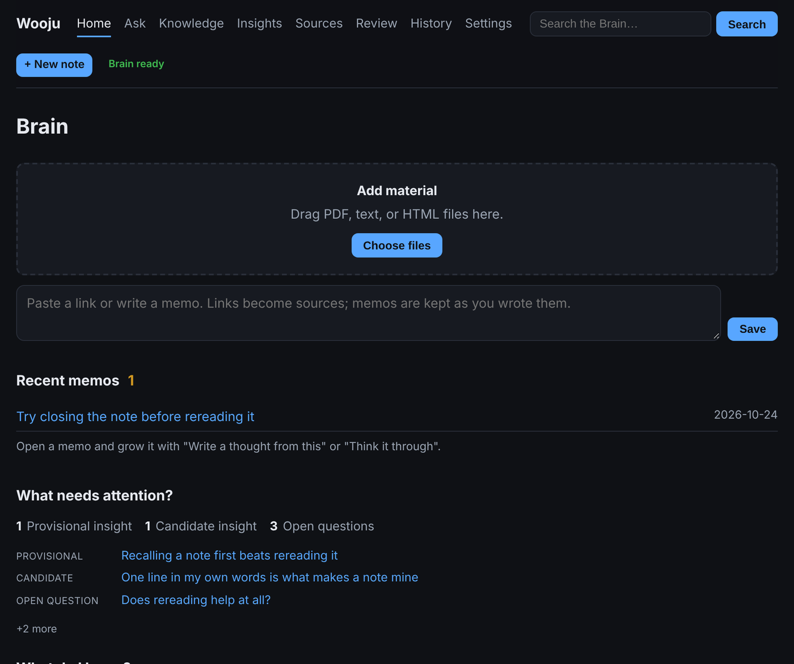
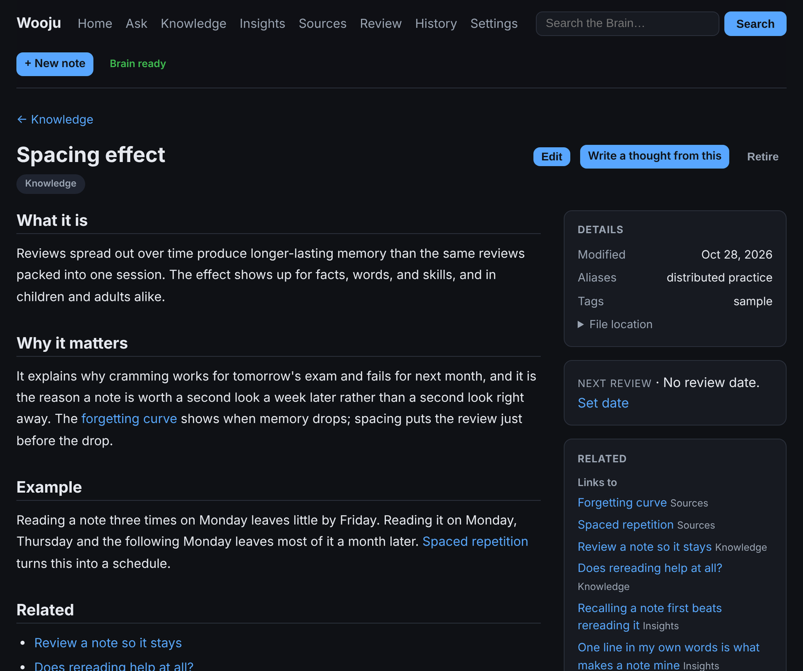
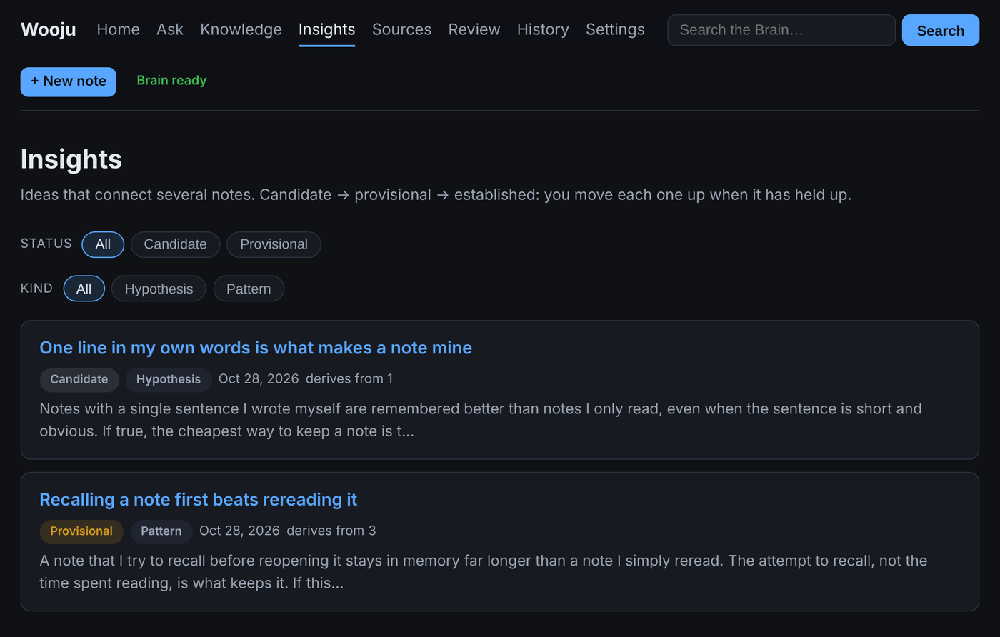

# Wooju

> Drop things in. Wooju turns them into notes you can trust, asks you the questions
> that make them yours, and brings them back with their sources when you need them.

Wooju is a personal knowledge app for the Mac. You give it articles, PDFs, links
and quick memos; a local AI organizes each one into a note, and Wooju helps you
think with what you saved: ask questions of your own notes, write your own ideas
on top of them, and keep them from fading.

**Status:** 0.5.0. [Download it](https://github.com/seulchan/wooju/releases/latest)
for an Apple Silicon Mac, or see [CONTRIBUTING.md](CONTRIBUTING.md) to build it yourself.

## What it does

- **Takes things in from anywhere.** Drag in files, paste a link, write a memo, or send
  one from your phone through an iCloud Drive folder or a Telegram bot.
- **Organizes them for you.** Each source becomes a short note: a one-line summary, the
  key points, what it does not cover, and a link to the original. If a new source
  disagrees with what you already have, Wooju says so.
- **Answers from your notes, with sources.** Ask a question and every sentence of the
  answer points to the note it comes from. If your notes don't cover something, it
  says that instead of guessing.
- **Asks you to think.** The AI asks questions; you write the answers. One line in your
  own words, a recall before rereading, and review dates keep what matters from fading.
- **Keeps ideas honest.** An idea starts as a candidate and is trusted only after it has
  been challenged: Wooju writes down what could make it wrong.
- **Works with Claude.** One click lets Claude Desktop search and read your notes.

  
  

## Your notes stay yours

- **On your Mac.** Your notes are a folder of plain Markdown files (your *Brain*) that
  any text editor can open. Nothing is locked in a database.
- **Local AI by default.** Wooju uses [Ollama](https://ollama.com) on your Mac, so your
  material never leaves it. An OpenAI or Claude API key is optional; with one, the
  material you organize is sent to that company.
- **Nothing changes behind your back.** The AI only proposes changes. Every change is
  checked against the Brain's rules, recorded in history, and can be undone.

## Getting started

1. Download `Wooju_0.5.0_aarch64.dmg` from the
   [latest release](https://github.com/seulchan/wooju/releases/latest), open it and drag
   Wooju into Applications.
2. Open Wooju. The first time, macOS says it can't check the app, because Wooju is not
   yet signed by an Apple developer account. Choose **Done**, open **System Settings →
   Privacy & Security**, scroll down and choose **Open Anyway** next to Wooju. You only
   do this once.
3. Choose a folder for your Brain (a new one is created for you).
4. Install Ollama when Wooju asks; it downloads the AI model it needs (about 7 GB on a
   16 GB Mac, less on an 8 GB Mac).
5. Drop in your first file, or press "Look around with sample notes" to explore first.

Wooju needs an Apple Silicon Mac. 16 GB of memory is recommended; 8 GB works with a
smaller model.

## Where it is going

The next releases make the review step worth having (every proposal shows its
source), add real ways to take your notes out, and enforce provenance when
notes are used. The plan and the evidence behind it: [docs/ROADMAP.md](docs/ROADMAP.md).

## Feedback

Found a problem or have an idea? [Open an issue](https://github.com/seulchan/wooju/issues/new/choose).
Security problems: see [SECURITY.md](SECURITY.md).

## License

Code: [Apache License 2.0](LICENSE). Brain template (`template/`) and sample
notes (`samples/`): [CC BY 4.0](template/LICENSE). See [NOTICE](NOTICE). "Wooju" is
the project's name and is not licensed for use by derived products.
